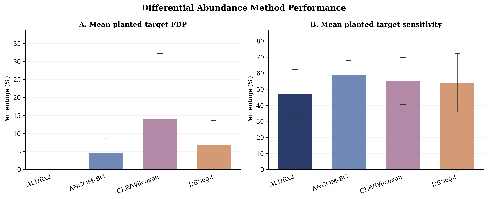
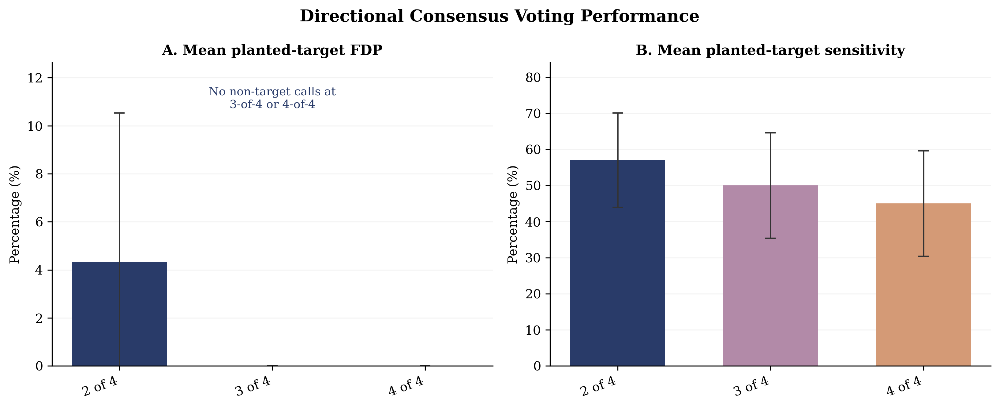
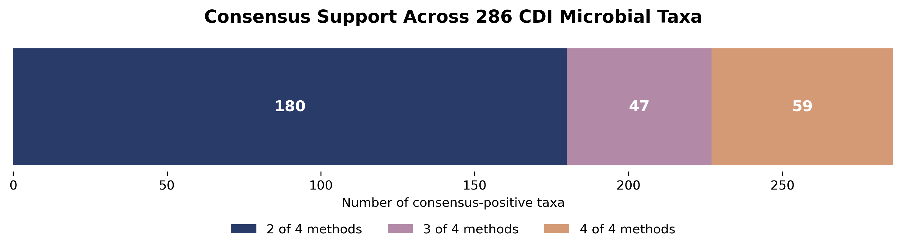

# Erin's Work

# Microbiome Abundance Consensus Machine
## Individual Contribution — Erin Maley

### Project Overview

This project compares four differential abundance methods used in
microbiome research:

- CLR/Wilcoxon
- ALDEx2
- ANCOM-BC
- DESeq2

The objective is to evaluate differences in statistical performance
and determine how agreement among methods can help prioritize
microbial taxa for further investigation.

### Computational Pipeline

The workflow uses Python and R and consists of seven stages:

1. Input preparation and formatting
2. Sample and taxon quality control
3. Differential abundance analysis using four methods
4. Standardization of statistical outputs
5. Cross-method comparison
6. Results quality control and validation
7. Direction-aware consensus reporting

### Simulation Benchmarking

Five independent simulated datasets were generated, each containing:

- 50 samples (25 Case and 25 Control)
- 100 microbial taxa
- 20 intentionally modified taxa
- Sample-level biological variability

Performance was evaluated using planted-target sensitivity and
false discovery proportion (FDP).

#### Individual Method Performance

| Method | Mean Sensitivity | Mean FDP |
|---|---:|---:|
| ALDEx2 | 47% | 0.0% |
| ANCOM-BC | 59% | 4.5% |
| CLR/Wilcoxon | 55% | 13.9% |
| DESeq2 | 54% | 6.8% |

### Consensus Voting

Consensus requires multiple methods to identify the same taxon
as significant and agree on the direction of its abundance difference.

- 2-of-4: At least two methods agree
- 3-of-4: At least three methods agree
- 4-of-4: All four methods agree

| Threshold | Mean Sensitivity | Mean FDP |
|---|---:|---:|
| 2-of-4 | 57% | 4.3% |
| 3-of-4 | 50% | 0.0% |
| 4-of-4 | 45% | 0.0% |

### Real Microbiome Data

The pipeline was applied to the publicly available
MicrobiomeHD cdi_schubert dataset.

The processed dataset contained 1,420 microbial taxa.

A total of 286 taxa met the directional-consensus criteria:

- 180 supported by exactly two methods
- 47 supported by exactly three methods
- 59 supported by all four methods

### Scientific Figures

#### Figure 1 — Differential Abundance Method Performance

#### Figure 2 — Directional Consensus Voting Performance

#### Figure 3 — CDI Consensus Support Distribution

### Limitations

The five-simulation benchmark is exploratory.

Because microbiome abundance data are compositional, intentionally
changing selected taxa can indirectly alter the relative abundances
of other taxa. Performance measures therefore describe detection
relative to intentionally modified taxa rather than definitive
biological ground truth.

The limited number of simulations also restricts the precision
of statistical performance estimates.

Consensus agreement does not establish biological correctness.

### Software

Python, R, pandas, NumPy, Matplotlib, ALDEx2, ANCOM-BC,
DESeq2, and SciPy.

### Future Work

- Expand repeated simulation benchmarking
- Evaluate additional effect sizes and sparsity conditions
- Further assess false-discovery behavior
- Improve biological interpretation of consensus-supported taxa
- Integrate results into the final group presentation
