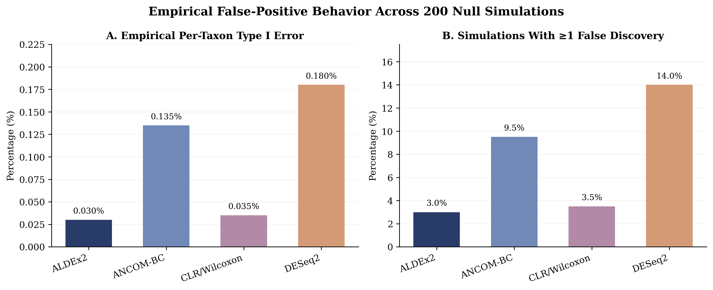
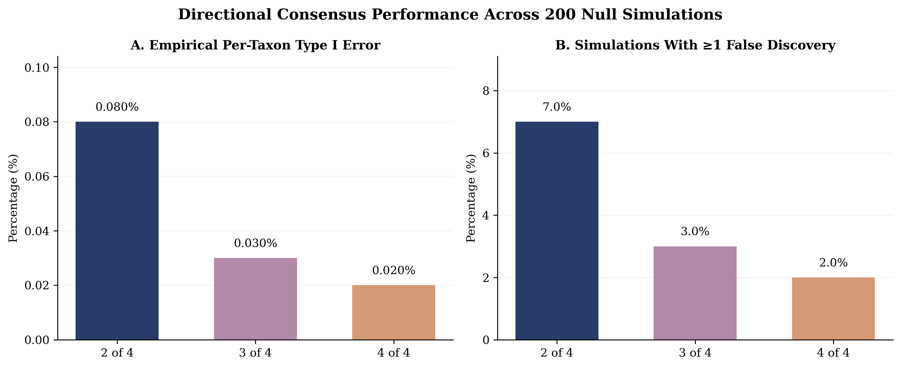

# Erin's Work

# Microbiome Abundance Consensus Machine
## Individual Contribution — Erin Maley

### Project Overview

This project compares four differential abundance methods used in
microbiome research:

- CLR/Wilcoxon
- ALDEx2
- ANCOM-BC
- DESeq2

The objective is to evaluate differences in statistical performance
and determine how agreement among methods can help prioritize
microbial taxa for further investigation.

### Computational Pipeline

The workflow uses Python and R and consists of seven stages:

1. Input preparation and formatting
2. Sample and taxon quality control
3. Differential abundance analysis using four methods
4. Standardization of statistical outputs
5. Cross-method comparison
6. Results quality control and validation
7. Direction-aware consensus reporting

### Simulation Benchmarking

Five independent simulated datasets were generated, each containing:

- 50 samples (25 Case and 25 Control)
- 100 microbial taxa
- 20 intentionally modified taxa
- Sample-level biological variability

Performance was evaluated using planted-target sensitivity and
false discovery proportion (FDP).

#### Individual Method Performance

| Method | Mean Sensitivity | Mean FDP |
|---|---:|---:|
| ALDEx2 | 47% | 0.0% |
| ANCOM-BC | 59% | 4.5% |
| CLR/Wilcoxon | 55% | 13.9% |
| DESeq2 | 54% | 6.8% |

### Consensus Voting

Consensus requires multiple methods to identify the same taxon
as significant and agree on the direction of its abundance difference.

- 2-of-4: At least two methods agree
- 3-of-4: At least three methods agree
- 4-of-4: All four methods agree

| Threshold | Mean Sensitivity | Mean FDP |
|---|---:|---:|
| 2-of-4 | 57% | 4.3% |
| 3-of-4 | 50% | 0.0% |
| 4-of-4 | 45% | 0.0% |

### Real Microbiome Data

The pipeline was applied to the publicly available
MicrobiomeHD cdi_schubert dataset.

The processed dataset contained 1,420 microbial taxa.

A total of 286 taxa met the directional-consensus criteria:

- 180 supported by exactly two methods
- 47 supported by exactly three methods
- 59 supported by all four methods

### Scientific Figures

#### Figure 1 — Differential Abundance Method Performance

#### Figure 2 — Directional Consensus Voting Performance

#### Figure 3 — CDI Consensus Support Distribution

## Repeated Null Simulation Benchmark (200 Simulations)

To evaluate false-positive behavior, I conducted 200 independent null simulations using 50 samples (25 Case and 25 Control) and 100 microbial taxa per simulation.

No differential abundance was intentionally introduced between the groups. All four statistical methods were applied to each simulated dataset, and their results were compared using empirical per-taxon Type I error and the proportion of simulations with at least one false-positive discovery.

### Individual Method Performance

| Method | Type I Error | Simulations With False Positives |
|---|---:|---:|
| ALDEx2 | 0.030% | 3.0% |
| ANCOM-BC | 0.135% | 9.5% |
| CLR/Wilcoxon | 0.035% | 3.5% |
| DESeq2 | 0.180% | 14.0% |

### Directional Consensus Performance

Consensus required multiple methods to identify the same taxon as significant and agree on its direction of abundance difference.

| Agreement Threshold | Type I Error | Simulations With False Positives |
|---|---:|---:|
| 2-of-4 | 0.080% | 7.0% |
| 3-of-4 | 0.030% | 3.0% |
| 4-of-4 | 0.020% | 2.0% |

### Interpretation

Stricter consensus thresholds reduced observed false-positive findings in these simulations, although unanimous method agreement did not eliminate them.

The results represent empirical behavior under the specific simulation model and should not be interpreted as establishing universal false-discovery-rate control.

The full per-simulation scoring tables and aggregate summaries are provided in `data/null_benchmark_12/`.
